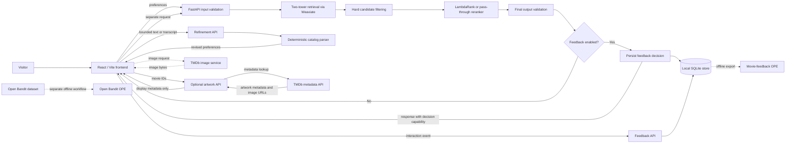

# Application architecture

## Components and data flow

The browser sends explicit favorites, hidden titles, genre constraints, and a requested result count to FastAPI. After request validation, learned serving retrieves a bounded candidate pool with the saved two-tower model and Weaviate. Hard filters remove disallowed candidates before the saved LambdaRank model reranks them. A pass-through reranker is used when LambdaRank is not configured. Final validation rejects results outside the retrieved-and-filtered candidate set or results that violate the submitted constraints.

Text or browser-provided speech transcripts take a separate path. The `/api/v1/refinements` endpoint uses the deterministic, bounded catalog interpreter to return revised preferences. The frontend then submits those preferences in a separate recommendation request. This path does not use an LLM. See [natural-language and voice search](natural_language_search.md).

Artwork is optional enrichment. The frontend sends movie IDs to the backend artwork endpoint, which obtains TMDb metadata and returns sanitized image URLs and display metadata. The browser then downloads images separately from TMDb's image service. Neither path changes candidate retrieval, filtering, or ranking.

When feedback collection is enabled, recommendation serving records the randomized or observed decision before returning its capability to the browser. Browser interaction events then pass through the feedback API before reaching the same local SQLite store. Exported movie-feedback data support the separate movie-feedback OPE workflow. Open Bandit OPE uses its own dataset and pipeline; neither offline workflow automatically changes live inference.

## Operational references

- [README setup, M4 reviewer entry point, and safe reproduction commands](../README.md)
- [Application System Card, safeguards, risks, and reproduction checklist](system_card.md)
- [Natural-language and voice search behavior](natural_language_search.md)
