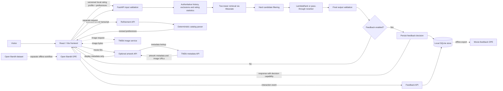

# Application architecture

## Components and data flow

The browser restores its versioned local profile before its first request and sends numeric rating records, actual timestamps, unresolved legacy favorites, visit-only hidden titles, genre constraints, and a requested result count to FastAPI. Hidden IDs use the ordinary exclusion field for the current page visit, can be individually removed in Preferences, and are not stored in the browser profile. The backend derives authoritative statistics and positive history from the validated request state. Ratings at least 4.0 feed positive history; every rated movie is removed before reranking and checked again after it. LambdaRank receives the request-scoped mean rating, `log1p` count, and live inactivity values without changing cached training statistics or the saved feature order. Missing values remain missing. See [browser rating profile and live model features](browser_rating_profile.md).

The main search area separates explicit movie lookup/rating from recommendation requests. Both modes accept typed input or optional browser-provided speech: title speech fills catalog search without selecting or rating a movie, and recommendation speech fills an editable request that still requires submission. The `/api/v1/refinements` endpoint uses the deterministic, bounded catalog interpreter to revise genres or resolve an exact “movies like” title. Resolved titles travel as request-scoped `temporary_history_items`: they reach retrieval and reranking without mutating the saved rating profile or favorites, and remain excluded from displayed results. This path does not use an LLM. See [movie and genre search](natural_language_search.md).

Artwork is optional enrichment. The frontend sends movie IDs to the backend artwork endpoint, which obtains TMDb metadata and returns sanitized image URLs and display metadata. The browser then downloads images separately from TMDb's image service. Neither path changes candidate retrieval, filtering, or ranking.

When feedback collection is enabled, recommendation serving records the randomized or observed decision, including the effective rating and temporary title context in versioned decision schema 3, before returning its capability to the browser. Personal rating changes are not exposure or reward events. Featured interactions still pass through the feedback API with their original decision/token and unchanged propensity/reward rules. Exported movie-feedback data support the separate movie-feedback OPE workflow.

## Operational references

- [README setup, M4 reviewer entry point, and safe reproduction commands](../README.md)
- [Full Linux API/frontend container packaging and existing-Weaviate reuse](container_application.md)
- [Application System Card, safeguards, risks, and reproduction checklist](system_card.md)
- [Natural-language and voice search behavior](natural_language_search.md)

## Container deployment boundary

The production frontend image serves the built React bundle through an
unprivileged nginx process. `/api/`, `/health`, `/ready`, and `/openapi.json` are
proxied to the API container; all other unknown paths use the SPA fallback.
`index.html` is not cached, while content-hashed assets are immutable. Proxy logs
record the path without query strings and never log request bodies.

The API image contains the application package trees and Linux dependencies but
no models or datasets. The complete prepared run, retrieval inputs, published
retrieval model, and `lambdarank_v1` directory are mounted read-only. The API joins
the explicitly inspected external Weaviate network and uses the `weaviate` service
name rather than container-local `localhost`. A bounded entrypoint wait precedes
the existing startup artifact and remote-vector audits. This establishes startup
readiness only; it does not prove recovery from a later Weaviate outage.
